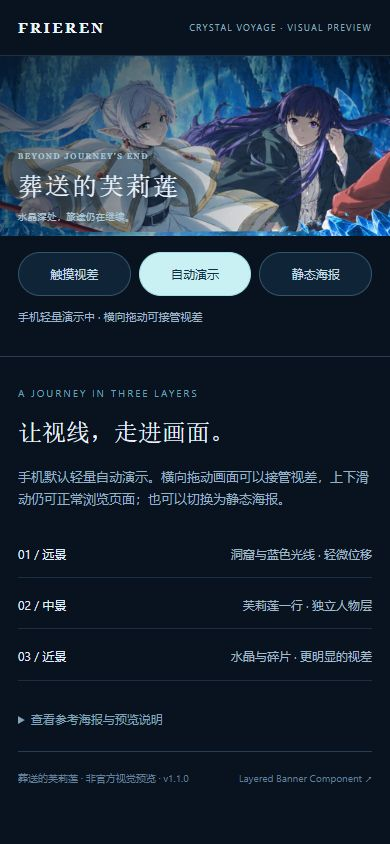

# Bilibili Parallax Banner

**独立、零运行时依赖的分层视差 Banner 组件。** 只负责指定容器里的横幅，不接管网站导航、搜索、路由、账号或其他业务。

An independent, dependency-free layered pointer-parallax banner inspired by Bilibili's header interaction. MIT licensed. Not affiliated with Bilibili; no Bilibili artwork or proprietary source is distributed.

## 效果预览

[](https://wushuai0802.github.io/bilibili-parallax-banner/examples/frieren/)

[打开交互预览](https://wushuai0802.github.io/bilibili-parallax-banner/examples/frieren/) · [下载离线 HTML](https://github.com/wushuai0802/bilibili-parallax-banner/releases/download/v1.1.0/frieren-banner-preview.html) · [查看示例源码](examples/frieren/)

桌面支持鼠标视差；手机默认轻量自动演示，并可横向拖动，竖向滑动仍正常浏览。系统减少动态效果优先生效。GitHub 介绍页展示的是动图，点击图片可进入真正的交互页面。

示例以《葬送的芙莉莲》第二季官方海报为参考进行 AI 重绘，非官方视觉图；[素材说明与来源](examples/frieren/README.md#素材说明)。

<details>
<summary>查看手机动态版的界面</summary>



</details>

## 接入入口

| 需要 | 文档 |
| --- | --- |
| 给网站开发者对接 | [完整接入指南](docs/INTEGRATION.md) |
| 替换素材、交付给画师 | [图片格式与替换标准](docs/ASSETS.md) |
| 参数、事件、生命周期 | [API 参考](docs/API.md) |
| 原站对照与支持范围 | [参考证据与兼容边界](docs/REFERENCE.md) |
| 开发维护 | [贡献指南](CONTRIBUTING.md) |

## 直接通过 script 引入

以下使用固定版本 CDN。把容器放到自己的网站中即可；导航、文字和按钮继续由你的网站实现。

```html
<link rel="stylesheet" href="https://cdn.jsdelivr.net/gh/wushuai0802/bilibili-parallax-banner@v1.1.0/dist/banner.css">
<div id="my-banner"></div>
<script src="https://cdn.jsdelivr.net/gh/wushuai0802/bilibili-parallax-banner@v1.1.0/dist/banner.min.js"></script>
<script>
  const banner = LayeredBanner.createBanner('#my-banner', {
    baseWidth: 1920,
    baseHeight: 180,
    pixelRatio: 2,
    poster: '/banner/poster.webp',
    layers: [
      { id: 'background', src: '/banner/01_bg.webp', offset: [6, 0] },
      { id: 'middle', src: '/banner/02_mid.webp', offset: [28, 6] },
      { id: 'foreground', src: '/banner/03_fg.webp', offset: [64, 12] }
    ]
  });
</script>
```

默认素材是 **3840×360**（1920×180 设计画布的 2 倍图）；中景和前景保留透明区域。
图片都由你自己的网站提供，组件不会访问 B站 API。

## JSON 清单接入

```js
const banner = await LayeredBanner.loadBanner('#my-banner', '/banner/summer/banner.json');
await banner.ready;
```

图片地址相对 `banner.json` 解析。素材目录、文件名、尺寸与图层含义保持一致时，**以后只需替换图片及静态海报**，不需要改代码。
只有图层数量、构图基准或位移需求变化时才调整清单。

## ESM / React / Vue

```js
import {createBanner, loadBanner} from './dist/banner.js';
```

也可以安装固定 Git 标签（此项目尚未发布 npm registry 包）：

```sh
npm install github:wushuai0802/bilibili-parallax-banner#v1.1.0
```

随后使用 `import {loadBanner} from 'bilibili-parallax-banner'` 和
`import 'bilibili-parallax-banner/style.css'`。React/Vue 的卸载清理示例在[接入指南](docs/INTEGRATION.md)。

## 本地预览和维护

```sh
npm ci --ignore-scripts
npm run check
npm run dev
```

打开终端显示的本机 HTTP 地址。也可以直接双击根目录 `index.html`：演示使用预构建经典脚本和自动生成的配置，不依赖 `fetch(file://...)`。

## 已实现

- 进入点为基准的横向视差；Y 方向可随横向输入联动；200ms 线性归位。
- 同画布模式自动计算共同出血缩放，透明图层保持对齐，覆盖手机至超宽屏。
- B站 split_layer v1 独立适配器：保留天然尺寸，支持初始值、偏移、旋转、模糊、透明度和曲线。
- `requestAnimationFrame` 合帧、容器 `ResizeObserver`、离屏/后台暂停。
- 静态海报、超时、必要图层失败兜底、可选图层失败降级。
- 触屏默认静止，可用 `interaction.touch:'drag'` 开启横向拖动与程序驱动演示；系统减少动态效果始终优先。
- `ready`、状态事件、暂停/恢复、卸载，以及 TypeScript 类型。
- PNG/WebP/AVIF/JPEG/SVG 的解码、真实透明像素、尺寸和文件引用校验。

## 不包含

网站的业务框架、自动抠图或单图生成纵深、B站插画素材、订阅 API、自动定时换主题，以及完整复刻某一期头图的像素承诺。
一张静态图片只能整体移动；前后景独立运动需要分层素材。

## 许可

组件代码和几何示例使用 [MIT](LICENSE)。影视主题展示素材不纳入组件的 MIT 授权，详见相应示例的素材说明。B站的美术与脚本不包含在发行物中。使用者应为自己的横幅素材保留相应授权。
